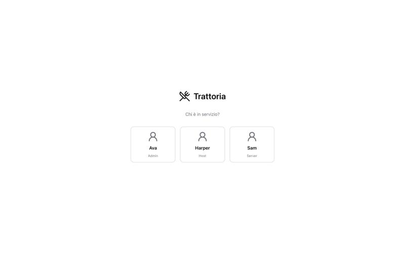
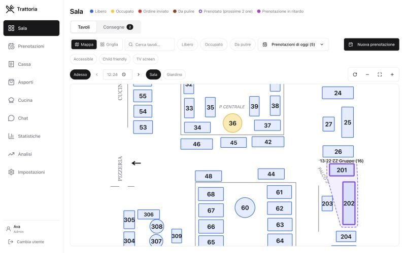
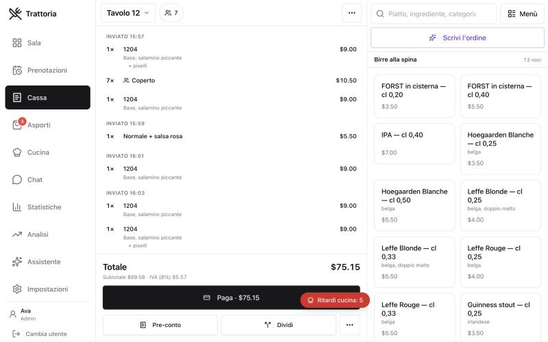

# Restaurant Bot

Restaurant Bot is a complete management system for a restaurant. It runs on one computer in the venue and every device on the local network can use it: the desktop at the till, the waiters' phones and a tablet in the kitchen.

It takes care of the whole service: the tables in the dining room, the orders, the kitchen tickets, the bill, takeaway, reservations and the numbers at the end of the night. The interface is in Italian by default and can be switched to English in the settings.

## Screenshots

**The start screen.** When the app opens, each member of the staff picks their name and signs in with a short PIN.



**The dining room map.** Every table shows its state with a colour, and a booked group of joined tables is outlined with its name and time.



**The till.** The open bill is on the left, the menu is on the right, and the AI assistant can turn a written order into lines.



## Main features

### Dining room and tables
* A drawn map of each room, with tables, walls, lines and labels, made in a simple editor inside the app.
* Every table shows its state with a colour: free, open, ordered, waiting for the bill.
* Tables can be linked together for big groups and moved to another table, whole or in part.

### Orders and the till (Cassa)
* Fast order entry with a search that finds dishes by name, code, ingredient or category, even with thousands of items in the menu.
* Per dish variations: add or remove ingredients, with prices worked out automatically.
* Quick notes on each line, cover charge asked once per table, and drafts that are kept until they are sent.
* Split the bill, change a price, print a pre bill, and pay by cash or card.

### Printing
* Direct printing to receipt printers on the network (ESC/POS), with each dish sent to the right station: kitchen, pizzeria or bar.
* Editable layouts for kitchen tickets and bills.
* If a printer is off, the tickets are held and every device shows a popup to reprint them.

### Kitchen display
* A live screen for the kitchen at `/kitchen`, with one tab per station.
* Tickets turn amber and then red as they wait, and the cook marks dishes as ready with one tap.

### Reservations and smart floor
* Reservations with phone numbers, notes and table preferences.
* An optional module that suggests the best tables for each booking, finds a seat for walk in guests and keeps a waiting list.

### Takeaway and delivery
* Takeaway orders with a nightly counter and saved labels.

### Phones and tablets
* A mobile version for waiters at `/m`: open a table, take the order, move it or take the payment from the phone.
* Waiters sign in with a short PIN, and every role sees only what it needs.

### Analytics
* Sales, best selling dishes, table turnover and hours of the day, with charts.

### AI assistant (prototype)
* A local AI model (Ollama, no cloud) that turns a written order like "2 margherite e una birra media" into lines on the bill.
* It can also suggest a table for a group, warn about late orders and explain the numbers.
* It is a prototype: it is off by default and only turns on with a flag in `.env.local`. See [docs/ai-module.md](docs/ai-module.md).

## Built with

* [Next.js 14](https://nextjs.org) and React, with TypeScript
* [Supabase](https://supabase.com) (Postgres database with live updates), running locally in Docker
* Tailwind CSS and Radix UI for the interface
* Recharts for the charts

## Getting started

You need Node.js 18, Docker Desktop and git.

1. Install the packages:

   ```bash
   npm install
   ```

2. Start Docker Desktop, then start the local database:

   ```bash
   npx supabase start
   ```

3. Copy the example settings and fill in the URL and key that `supabase start` printed:

   ```bash
   cp .env.local.example .env.local
   ```

4. Create the tables and load the sample data:

   ```bash
   npx supabase db reset
   ```

5. Start everything with the helper script:

   ```bash
   ./rms start
   ```

Then open http://localhost:3000 on the computer. To use the app from phones and tablets, run `./rms status`: it prints the address to open on the local network.

Other commands of the helper script: `./rms stop`, `./rms restart` and `./rms logs`.

## Project structure

| Folder | What it holds |
| --- | --- |
| `src/app` | The pages: dining room, till, kitchen, reservations, settings, mobile version |
| `src/components` | The building blocks of the interface |
| `src/lib` | The logic: printing, pricing, smart floor, AI assistant, translations |
| `supabase/migrations` | The database schema, step by step |
| `docs` | Extra documentation |
| `llm_tests` | Tests and benchmarks for the AI assistant |
